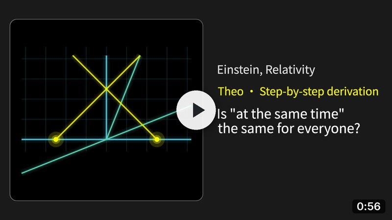
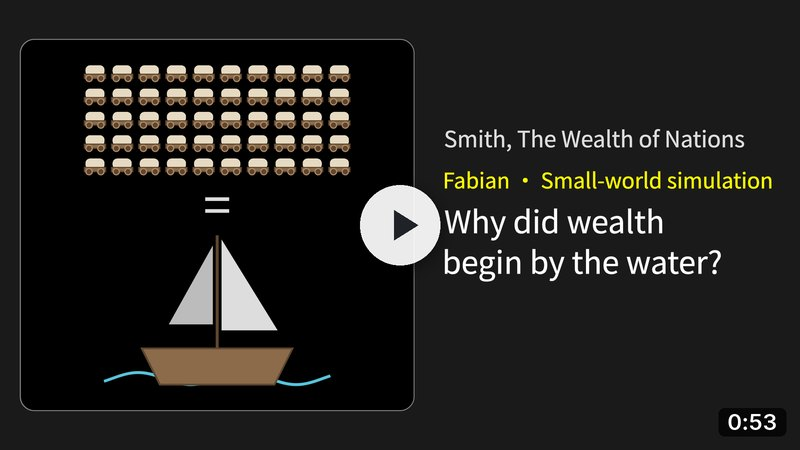
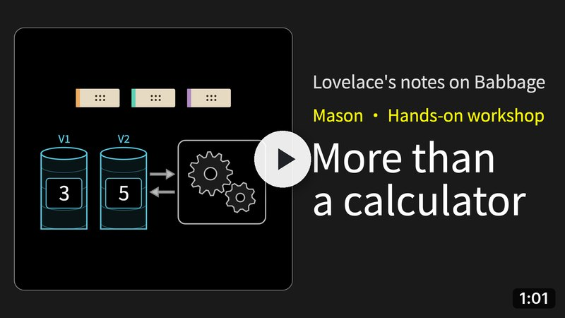
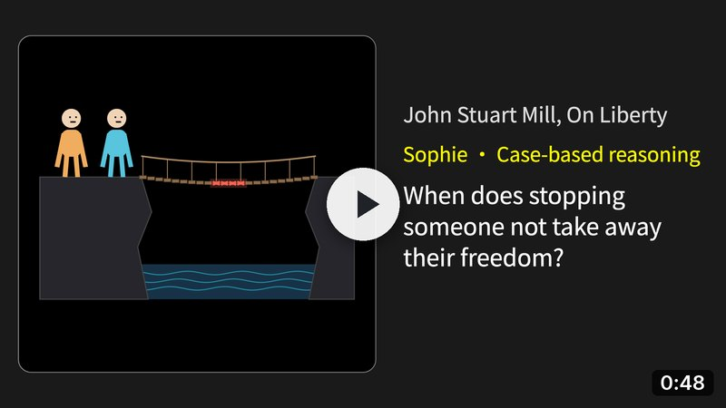
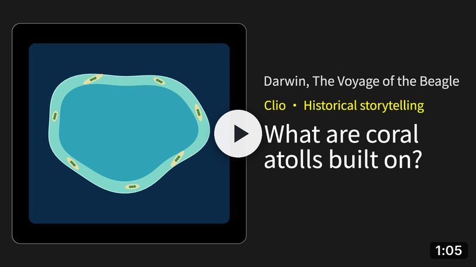

<div align="center">


**Turn any material into explainer videos, with your coding agent.**

[Examples](#examples) · [Install](#install) · [Discord](https://discord.com/invite/KAkXjPX8Yn) ·
[Website](https://heptabase.com)

</div>

Give your coding agent lecture notes, a book chapter, a paper, a design document or a codebase. It works out who the
videos are for and plans a series of episodes, each answering one question. Explainer Studio then makes the narrated,
animated episodes on your computer, rendered with [ManimGL](https://github.com/3b1b/manim), the engine behind
3Blue1Brown's videos. Runs on macOS, Windows and Linux.

<a href="#examples"></a>

<p align="center"><sub>Moments from the five one-minute demos below. <a href="#examples">Watch them with sound</a>.</sub></p>

## How it works

<p>


</p>

## Why the videos work

- **Made for your viewer.** The agent finds out what your viewer already knows before it plans anything.
- **One question per episode.** Everything in an episode serves a single question, such as why something happens or
  how it is done.
- **A teacher that fits.** Each episode gets the presenter whose way of explaining suits its question.
- **Fixed where you got lost.** Press <kbd>M</kbd> on the video page where you lose the thread, and the agent makes the
  next version.

## Examples

The five presenters, each with a one-minute demo made with Explainer Studio from a classic text. A full episode usually
runs 10 to 20 minutes. The players start muted: turn on the sound to hear the narration.

<table>
<tr>
<td width="45%"><a href="https://github.com/user-attachments/assets/c20239bb-5a7b-48ee-8208-d2b9418ffbbc"></a></td>
<td>
<p><b>Theo</b> · Step-by-step derivation</p>
<p>Rebuilds the idea in pictures, one step at a time, until the result feels inevitable.</p>
<p><b>Best for</b><br>Why something happens, why it must be true, or what a concept really is.</p>
<p><b>Demo</b><br><i>Is "at the same time" the same for everyone?</i><br><sub>From Albert Einstein, <i>Relativity</i> (1916)</sub></p>
</td>
</tr>
<tr>
<td><a href="https://github.com/user-attachments/assets/8b88e1b6-a334-4a99-80f4-eb28d70cf545"></a></td>
<td>
<p><b>Fabian</b> · Small-world simulation</p>
<p>Recasts the problem as a small world of players, then shows the outcome emerging from each player’s choices.</p>
<p><b>Best for</b><br>How the players in a system produce its result.</p>
<p><b>Demo</b><br><i>Why did the first rich societies grow along coasts and rivers?</i><br><sub>From Adam Smith, <i>The Wealth of Nations</i> (1776)</sub></p>
</td>
</tr>
<tr>
<td><a href="https://github.com/user-attachments/assets/4becb1ef-4fe1-49c3-9bde-3f9e5ff9100f"></a></td>
<td>
<p><b>Mason</b> · Hands-on workshop</p>
<p>Builds a mini version of the idea and tinkers with it until it clicks.</p>
<p><b>Best for</b><br>How something is done or built.</p>
<p><b>Demo</b><br><i>What made Babbage's Analytical Engine more than a calculator?</i><br><sub>From Ada Lovelace's notes on the Analytical Engine (1843)</sub></p>
</td>
</tr>
<tr>
<td><a href="https://github.com/user-attachments/assets/bc0f0f76-b319-470b-bf77-9d8fdaedd5c3"></a></td>
<td>
<p><b>Sophie</b> · Case-based reasoning</p>
<p>Tweaks a real-life case bit by bit to find what really matters.</p>
<p><b>Best for</b><br>Open questions where reasonable views disagree.</p>
<p><b>Demo</b><br><i>When does stopping someone not take away their freedom?</i><br><sub>From John Stuart Mill, <i>On Liberty</i> (1859)</sub></p>
</td>
</tr>
<tr>
<td><a href="https://github.com/user-attachments/assets/0db93689-9add-4b1a-bc4b-b2bc62e46868"></a></td>
<td>
<p><b>Clio</b> · Historical storytelling</p>
<p>Tells how it happened, one turning point at a time.</p>
<p><b>Best for</b><br>What happened, and why it went that way.</p>
<p><b>Demo</b><br><i>What are coral atolls built on?</i><br><sub>From Charles Darwin, <i>The Voyage of the Beagle</i> (1845)</sub></p>
</td>
</tr>
</table>

How the agent decides what each episode teaches, and how the presenters differ, is in the
[teaching model](docs/teaching-model.md).

## Install

> [!IMPORTANT]
> **Your first video takes much longer than the ones after it.** Before it, the agent installs about 1.5 GB of tools
> (ManimGL, LaTeX, ffmpeg and fonts), which alone takes several minutes, then gets to know your viewer, reads all of
> your material and plans the whole series. Later episodes skip all of that.

You need [Claude Code](https://claude.com/claude-code) or [Codex](https://github.com/openai/codex), about 1.5 GB of disk
space and, for narration, a key from one of the providers in
[Narration, languages and cost](#narration-languages-and-cost). On macOS a free built-in voice lets you start without
one.

> [!NOTE]
> Explainer Studio is developed and tested with Claude Code and Claude Opus 5.5. It also works in Codex, but for now
> GPT models are likely to make weaker videos than Claude models.

1. Add the Heptabase plugin, which carries Explainer Studio, from your agent's plugin store, which keeps it up to date:

   - **Claude Code:** [Heptabase in the Anthropic plugin directory](https://claude.ai/customize/plugins/id/fa2e0242-7664-4b42-934e-d79662df31a1%40anthropic-plugin-directory)
   - **Codex:** [Heptabase in the ChatGPT and Codex plugin directory](https://chatgpt.com/plugins/plugin_asdk_app_6a8df1b568f08191af42b4e26e012044)

   You need no Heptabase account to make videos. To use commands instead, see
   [Install with commands](#install-with-commands).
2. Ask: "Make an explainer video from `<your file>`". The first time, the agent checks your computer and, once you
   agree, installs the `explainer-studio` command and the tools above. Nothing needs an administrator password.
3. The agent asks who the videos are for, reads your material, and opens the plan in your browser: the episodes, the
   question each one answers and who presents it. Nothing is made until you tell it to start.
4. It makes the first episode and opens it on the video page, where you mark the moments you got lost.

After that, the `explainer-studio` command upgrades itself to each new release before your next episode.

### Install with commands

In Claude Code, add the marketplace and the plugin:

```text
/plugin marketplace add heptameta/heptabase-agent-plugins
/plugin install heptabase@heptabase-agent-plugins
```

Then let it update itself: run `/plugin`, open **Marketplaces**, select `heptabase-agent-plugins` and choose
**Enable auto-update**.

In Codex, add the marketplace, then open `/plugins` and install `heptabase` from `heptabase-agent-plugins`. Codex
updates it each time it starts.

```bash
codex plugin marketplace add heptameta/heptabase-agent-plugins
```

## Narration, languages and cost

Narration uses your own key from [ElevenLabs](https://elevenlabs.io), [OpenAI](https://platform.openai.com) or
[VoAI](https://voai.ai). Enter it in your terminal, so it never goes through the chat:

```bash
explainer-studio setup narration
```

Narration is capped at $20 per series unless you set another budget: tell the agent, or set it on the plan page. With
ElevenLabs it costs about 6 US cents a minute (Explainer Studio's estimate for the demos above), so a 10 to 20 minute
episode comes to roughly $0.60 to $1.30.

You choose the language of the narration and subtitles. English and Traditional Chinese (Taiwan) have their own guides
to spoken style, subtitles and fonts; other languages have none yet.

Apart from narration, the only cost is your coding agent's own usage.

## Your data

Everything is made and kept on your computer. Narration sends each line's text to the provider you chose. An episode's
feedback (your comments and rating, frames of the video around your comments, the script and the plan) reaches the
Explainer Studio team only when you agree to share it; your sources, the video file and the audio never do.
[PRIVACY.md](PRIVACY.md) lists exactly what leaves your computer.

## Getting help

The agent fixes most errors on its own. When it cannot, run `explainer-studio doctor` and
[open a bug report](https://github.com/heptameta/heptabase-explainer-studio/issues/new?template=bug_report.yml) with what it
prints. Ask questions and share ideas in our [Discord](https://discord.com/invite/KAkXjPX8Yn). Report a security problem
privately, as [SECURITY.md](SECURITY.md) describes.

## Contributing

Explainer Studio is young and changes quickly; [CHANGELOG.md](CHANGELOG.md) says what each release changed. Pull
requests are welcome: [CONTRIBUTING.md](CONTRIBUTING.md) says how to try a change and what to send, and your coding
agent follows [AGENTS.md](AGENTS.md). Every command and its options are in [docs/cli.md](docs/cli.md). Everyone who
takes part follows the [code of conduct](CODE_OF_CONDUCT.md).

## Credit

We would appreciate a credit wherever your work names the tools it is built with. The license does not ask for it, but
each credit brings more people and their feedback, and that feedback makes the videos better for everyone, yours
included:

- **In text:** `Built with [Heptabase Explainer Studio](https://github.com/heptameta/heptabase-explainer-studio)`
- **As a badge,** which follows the reader's light or dark theme on GitHub:

  
  

  <details>
  <summary>The badge's HTML</summary>

  ```html
  <a href="https://github.com/heptameta/heptabase-explainer-studio">
    <picture>
      <source media="(prefers-color-scheme: dark)" srcset="https://raw.githubusercontent.com/heptameta/heptabase-explainer-studio/main/docs/images/built-with-dark.svg">
      
    </picture>
  </a>
  ```

  </details>
- **With a video:** every episode ends on an end credits page that says it was made with Heptabase; keep it on. In
  the video's description: `Made with Heptabase Explainer Studio`
- **In a paper or a course:** GitHub's "Cite this repository" button gives the citation from
  [CITATION.cff](CITATION.cff).

Made something with it? Share it in our [Discord](https://discord.com/invite/KAkXjPX8Yn): we like to see what people
make.

## Acknowledgements

Explainer Studio's presenters blend many teaching techniques we learned by studying the public videos, transcripts and
talks of teachers we admire: 3Blue1Brown, CGP Grey, Nicky Case, Andrej Karpathy, Bret Victor, Michael Sandel, Johnny
Harris, the Imperial War Museums and many others. None of them is affiliated with Heptabase or Explainer Studio, or
has endorsed it.

Scenes are animated with [ManimGL](https://github.com/3b1b/manim), the engine Grant Sanderson wrote for 3Blue1Brown.

## License

Apache-2.0 ([LICENSE](LICENSE)). The copyright notice is in [NOTICE](NOTICE), which a redistribution must carry along
(section 4(d) of the license), together with the notices of the third-party parts it lists: code adapted from ManimGL
(MIT, [licenses/ManimGL-LICENSE.txt](licenses/ManimGL-LICENSE.txt)) and the Inter typeface (SIL Open Font License).
Two dependencies are used unmodified under copyleft licenses: grandalf (EPL-1.0) and verovio (LGPL-3.0).

### Trademarks

You are welcome to say "Built with", "Based on" or "Made with" Heptabase Explainer Studio in your work, and to show the
badge from [Credit](#credit) unmodified, linking to this repository. Heptabase and the Heptabase logo are trademarks of
Hepta Platforms, Inc.; the license does not grant permission to use them otherwise (section 6), and the logo artwork is
not covered by it. A fork, or a product built on Explainer Studio, needs its own name and logo and should not suggest
that Heptabase made or endorses it. The name and logo appear in the end credits
(`explainer_studio/scene_kit/credits.py`), the pages' header and icon (`explainer_studio/web/pages.py`) and
`docs/images/`; replace them there. Shared feedback goes to Heptabase (`explainer_studio/feedback_bundle.py`): point it
at your own service or turn sharing off.
