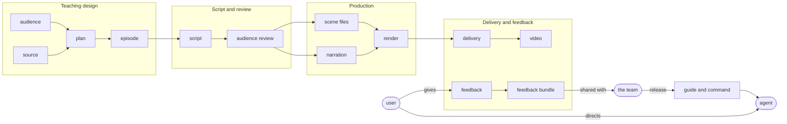
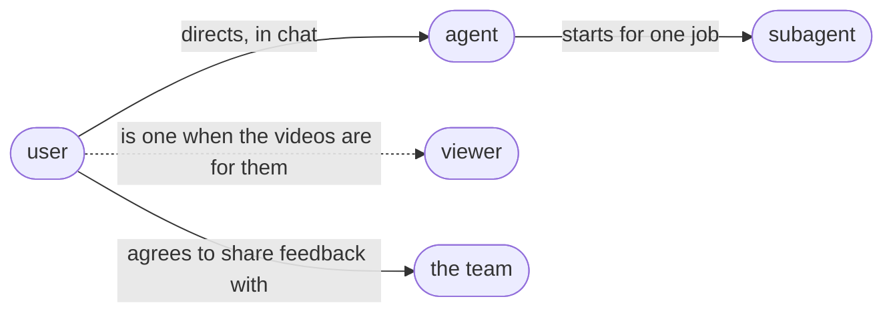
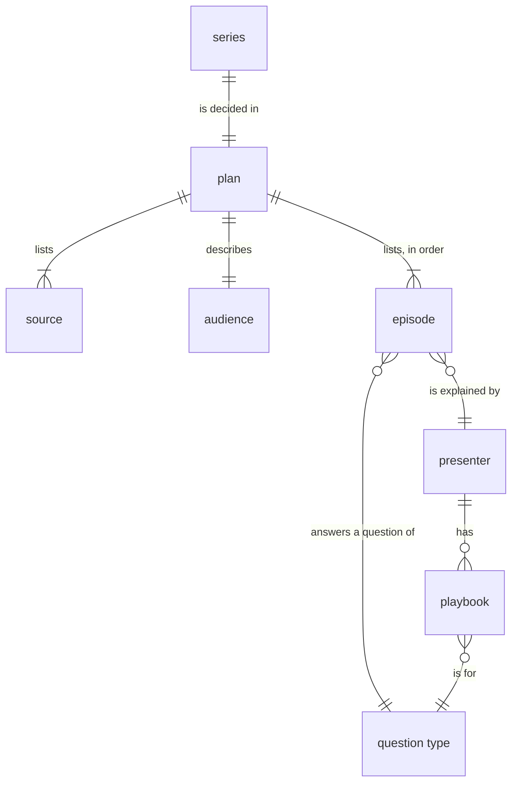
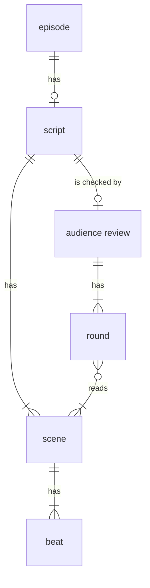
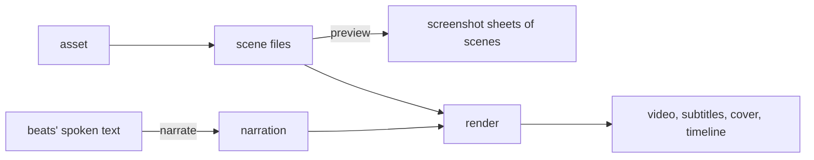
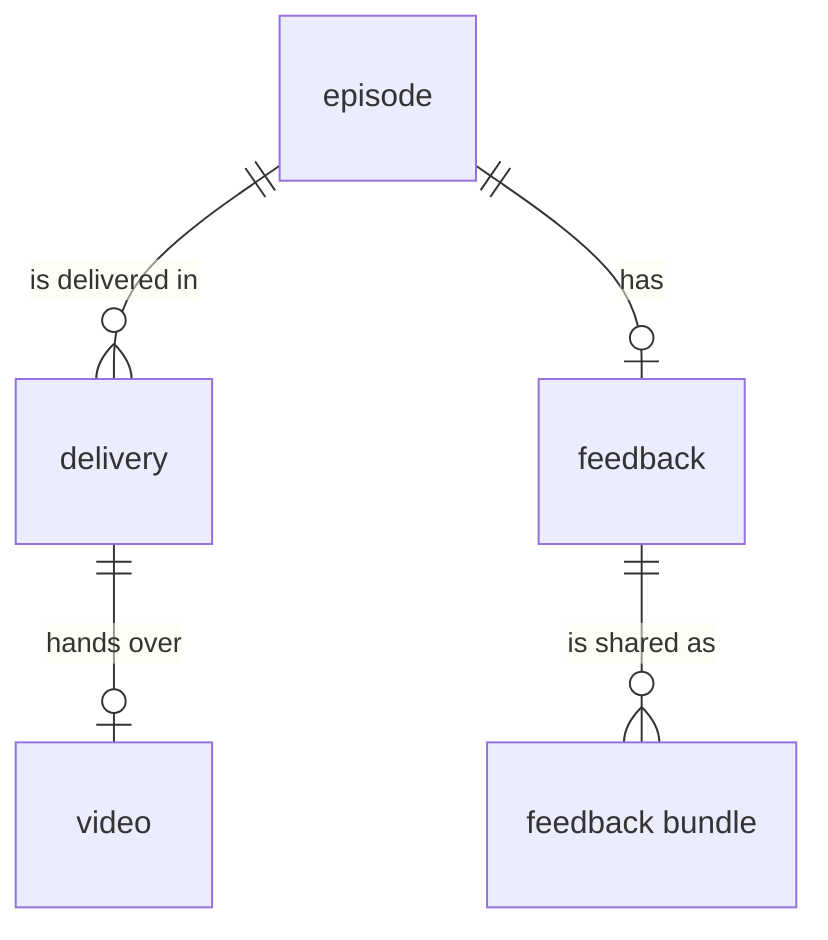
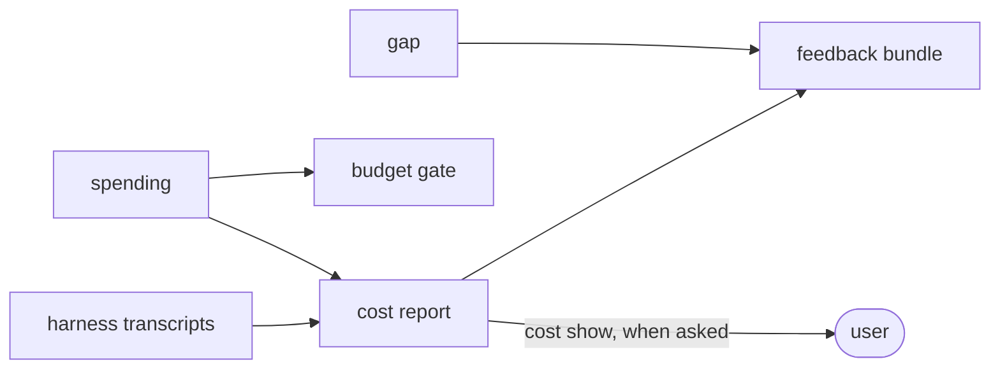
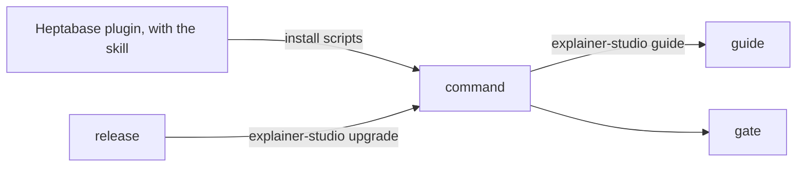

# Glossary

The main abstractions of Explainer Studio, how they relate, and the name each one has everywhere: in code, file
formats, commands and documentation. The model comes first, domain by domain; [Other terms](#other-terms) then lists
the smaller names that are stable enough to look up. How the parts work together step by step is in
[system-design.md](system-design.md), and the fields of every file are in
[`references/file-formats.md`](../explainer_studio/guide/references/file-formats.md). Paths are relative to a series
folder's `production/`.

## The whole picture

A user directs an agent. The agent plans a series from the user's sources for an audience, writes each episode's
script, has it checked by an audience review, and runs the command that turns it into a video. The user's feedback on
the video goes, when they agree, to the team, whose releases change the guide and the command the agent works with.

Each domain below has a diagram of its abstractions and a definition of each.

## People and agents

Who acts. The command only does what it is told; every decision is made by a person or an agent.

**user**: The person who asks for the videos and directs the agent in chat: they review the plan, watch the videos,
comment and decide whether to share feedback. When they make the videos to learn their sources, they are also a
viewer; when they make them for others, such as a teacher for students, they are not.

**viewer**: Someone who watches a video to learn from it: a member of the audience it is made for. When the guide says
"the viewer", it means a typical one; a real viewer can differ from what the audience describes.

**agent**: The coding agent the user talks to, in a harness such as Claude Code, that makes the videos by following
the guide: it plans, writes the scripts and the scene code, runs the command and looks at the results.

**subagent**: A fresh agent the agent starts for one job, without the conversation, from what it is given: an
**audience reviewer** reads a script as the audience would, and a **scene writer** writes scene files from a shared
brief.

**the team**: The Heptabase Explainer Studio team, who receive shared feedback bundles and change the product.

## Teaching design

What the series teaches, to whom, and how it is split into episodes. The agent works it out with the user before
anything is made, and the plan records it. Which of these decides what, and the presenters there are today, is in
[teaching-model.md](teaching-model.md).

**series**: Everything made from one set of sources for one audience, in one series folder: a plan and one or more
episodes. A series exists once its plan exists.

**source**: One piece of the teaching material a series is made from: notes, a book chapter, a paper, a design
document, a codebase. Before planning, the agent reads the chosen part of the sources in full (`sources/`).

**plan**: What the series will be: its sources, its audience, what the viewer can do at the end (the goal), its
episodes in order, and the production settings (narration, budget, background music). The agent writes it before
production; the user reviews it, on the plan page or in chat, and says in chat when to start. It stays the current
plan, changed when an episode needs it (`plan.yaml`).

**audience**: The plan's description of who the series is for: what they already know and picture, which terms are
unfamiliar to them, what they wrongly believe (each with the evidence for it), and how much they can take in per
episode. It may describe the user or the people the user makes the videos for. Planning, writing and the audience
review are all judged against it. It is a description, not a person; the people who watch are viewers.

**episode**: One video's worth of teaching: it answers one question, explained by one presenter, with what the viewer
should take away. Episodes are ordered so each builds on what the earlier ones taught, and their ids follow that
order (`ep01`, `ep02` …). An episode has a script once written and a video once delivered (`episodes/<episode>/`).

**question type**: The kind of question an episode answers, one of nine: mechanism, proof, concept, system, procedure,
narrative, conceptual change, argument and perspectives. It decides what the episode must contain and what the viewer
can do afterwards.

**presenter**: A way of explaining, written as a teacher with a character (Theo, Clio …): a craft, a style and its
playbooks. Each episode has one; it is not the voice.

**playbook**: How one presenter answers one question type: the skeleton an episode follows from opening to close, and
how it meets that question type's must-haves in the presenter's own way
(`references/presenters/<presenter>/question-types/<type>.md` in the guide). A presenter has at most one playbook per
question type, and several presenters can each have one for the same question type. An episode follows its presenter's
playbook for its question type; when there is none, it uses a draft playbook.

## Script and review

What each episode says and shows, beat by beat, and the check that its audience can follow it before any narration
is paid for.

**script**: What an episode says and shows, as scenes of beats. The agent writes it after thinking the episode
through in its design notes (`episodes/<episode>/script.yaml`).

**scene**: A stretch of the video with one purpose. One scene file draws it.

**beat**: The unit everything is timed, narrated and checked by: one narration text and the picture shown while it is
spoken. Its **narration text** is what it says, and the subtitles show it. What the voice reads is its **spoken
text**: the narration text rewritten automatically into speakable form (Greek letters by name, years as the language
reads them), or an override the agent writes when the rewrite is not enough. A beat also describes its picture for the
scene code and can cite where in the sources it comes from.

**audience review**: The check, before narration, that the audience can follow the script; the guide calls it the
script audience review. In each **round**, a new audience reviewer reads some scenes once, as a listener who cannot
read ahead, and lists where it got lost, what is inaccurate or overclaimed, and minor problems; the agent fixes each
finding or keeps it with a reason. The first round reads every scene; scenes where the reviewer got lost are read
again, for at most three rounds in all, and `narrate` refuses until that is done
(`episodes/<episode>/audience-reviews/script.yaml`).

## Production

How an episode becomes a video. The command does the work; the agent writes the scene code and looks at what comes
out.

**narration**: An episode's voice-over: each beat's spoken text made into speech by a narration provider (ElevenLabs,
OpenAI, VoAI, or the free macOS voice) with the plan's narration settings for the episode. Paid narration counts
against the series' narration budget; `narrate` reuses a beat's audio while its spoken text and the narration settings
stay the same (`episodes/<episode>/narration/`). Not the narration text, which is what a beat says.

**scene file**: The code that draws one scene with ManimGL and scene_kit, and plays its sounds
(`episodes/<episode>/scenes/<scene_id>.py`). The agent or a scene writer writes it.

**preview**: Rendering some scenes while writing them, so the agent can look at their screenshot sheets and automatic
checks. It needs no narration.

**render**: Making the episode's video from its scene files, narration, sounds and background music, with the
subtitles, the cover, and the timeline that ties each moment to its beat. The agent cannot watch a video, so it looks
at the render's screenshot sheets before delivering (`episodes/<episode>/render/`).

**asset**: A file a scene shows that scene code does not draw: a picture, a figure from a PDF, data, a clip, a 3D shot
or a screen recording, made or fetched with the `asset` commands or added by hand, with credits saying where it came
from.

## Delivery and feedback

What happens once a video exists: handing it over, the user's reactions, and sharing them with the team.

**video**: The delivered file of an episode in the series folder, with its subtitles and cover. Only the latest
delivery's is kept.

**delivery**: Handing an episode's video to the user after the final checks. Each delivery keeps a delivery record
(when, which Explainer Studio version, and the script and timeline as delivered) forever, so a comment on an earlier
video still finds the line it was about.

**feedback**: An episode's reactions from the user, across deliveries: comments, each about a moment or the whole
episode and later given the agent's resolution, and answers to the video page's survey. The user gives it on the video
page or in chat; which video an item is about follows from when it was given (`episodes/<episode>/feedback.json`).

**feedback bundle**: An episode's feedback packed with what the team needs to analyse it, including the plan, the
gaps and the cost report. It is sent only when the user agrees, and the latest supersedes earlier ones. It never
carries the sources, the video file or the audio; [system-design.md](system-design.md#what-leaves-the-computer) lists
what it does carry.

## Observation

How the team, and the user when they ask, see what making a series took and where the product fell short.

**cost report**: What making a series took: every model call of the agent and its subagents and every paid narration
call, each counted in a step, with each step's working time. It is worked out from the harness's transcripts when
asked, never stored, and records the agent's usage, not dollars, and the narration's estimated cost (`cost show`).

**spending**: The record of every paid call; today, narration. The budget gate adds it up (`spending.jsonl`).

**gap**: Something the product could not do, at any step, and what the agent did instead, recorded for the team
(`gaps.json`).

**dev mode**: A per-computer setting for people improving Explainer Studio. It adds the cost report to `deliver`'s
output and the video page, in dollars from a local price table, and asks how closely the user watched; it never
changes how a video is made.

## The product

What a user installs, what it enforces, and how new versions reach them.

**plugin**: The Heptabase plugin, which users install into Claude Code or Codex. Besides Heptabase's own tools, it
carries the skill (`heptameta/heptabase-agent-plugins`).

**skill**: What tells the agent to use Explainer Studio: it installs the latest release of the command and sends the
agent to the guide. Every installed plugin keeps its copy until the plugin is updated, so it changes rarely.

**command**: The `explainer-studio` CLI. It does what can be checked or must be exact: production, validation, the
gates and every call to an outside service.

**gate**: A point where the command refuses to go on, because skipping a step would cost money or ship a broken
video: the audience review and the budget before narration, current narration and valid scene code before rendering,
and a current render without text too small before delivery. Everything else the agent decides.

**guide**: How to make the videos, including the flow the agent follows. It is installed with the command and printed
by `explainer-studio guide`, so it always matches the version that runs.

**release**: A version tagged on `main`. The skill installs the latest release, and the agent upgrades the command
to it before each series and episode; what earlier series must change is in `UPGRADING.md`.

**dev build**: A version made from a commit that is not released, installed on one computer to develop and test.

## Other terms

Smaller names with a stable meaning, by domain. Each says which abstraction it belongs to.

**People and agents**

- **harness** (agent): The program the agent runs in, such as Claude Code; its transcripts are what the cost report is
  worked out from.
- **main agent** (agent): The agent itself, as opposed to its subagents.

**Teaching design**

- **goal** (plan): What the viewer can do after the whole series.
- **production settings** (plan): The narration settings, the narration budget and the background music: the part of
  the plan the plan page can change.
- **plan page** (plan): The local page where the user reviews the plan and changes its production settings
  (`plan open`).
- **unfamiliar term** (audience): A term the audience does not know; the scripts teach each before using it.
- **misconception** (audience): Something the audience wrongly believes, with the evidence for it; the scripts give
  each one a place where it is handled.
- **capacity** (audience): How much new content a viewer can take in per episode; planning splits the sources so no
  episode goes past it.
- **learner**, **teacher** (audience): The two kinds of user. A learner makes the videos for themselves and is the
  viewer; a teacher (an author, a lecturer, a team) makes them for other people and is asked about those viewers.
- **probe** (audience): A question the agent asks the user before planning, to learn what the viewer knows and how they
  like to be taught. Among them, the **depth probe** offers passages on one concept at different depths, and the
  **presenter probe** one passage in the way of each presenter whose playbook fits, to help choose between them.
- **question** (episode): What an episode answers, in the viewer's words.
- **takeaway** (episode): The one sentence the viewer should leave an episode with.
- **taught term** (episode): A term an episode teaches; with the takeaway, the taught terms tell the audience review of
  later episodes what earlier ones taught.
- **concept goal** (episode): For a concept episode, `use`: applying the concept as a tool, instead of telling it
  apart from others.
- **draft playbook** (playbook): A playbook the agent writes in an episode's design notes when its presenter has none
  for its question type; the plan page marks the episode. A release adds a playbook for that presenter and question
  type once their way can carry it and episodes made with draft playbooks for it were judged good on two different
  sources.
- **series folder** (series): The folder that holds a series: the delivered videos at its root, everything else in
  `production/`.
- **research** (series): The agent's notes from reading the sources (`research/`).
- **series bible** (series): What must stay consistent across the series: audience and tone, concept colours,
  recurring devices, translations of terms, the episode format (`series-bible.md`).
- **decisions** (series): Choices the agent made without asking, and why (`decisions.md`).

**Script and review**

- **design notes** (episode): The agent's free-form thinking before writing the script, its self-check included
  (`episodes/<episode>/design.md`).
- **self-check** (episode): The agent's check of its own work against the guide's list, before narration and before
  delivery.
- **citation** (beat): Where in the sources a beat's narration text comes from.
- **finding** (audience review): One problem a reviewer listed: lost, wrong or minor, with the agent's resolution.
- **validation** (plan, script): A command's check of a file's format (`plan validate`, `script validate`).

**Production**

- **narration settings**, **narration provider**, **narration budget**, **narration record** (narration): The plan's
  narration block for an episode (provider, voice and options), the service that speaks, the series' cap on narration
  spending, and the record of what each beat's audio was made from
  (`episodes/<episode>/narration/narration.yaml`).
- **background music settings**, **background music provider** (render): The plan's background music block, and what
  makes the music (today, a piano synthesized on the computer, or none).
- **scene_kit** (scene file): The library scene files import.
- **sound** (scene file): A sound effect or audio file a scene plays at a moment.
- **cover** (render): The picture in the video's first second, also delivered beside it, so a chat app's preview is not
  black.
- **end credits** (render): The page held for the video's last seconds: what the episode is based on, the external
  material it shows, and "Made with" over the Heptabase app icon and name (`end_credits.py`; `has_end_credits` in the
  plan turns it off).
- **timeline** (render): Where every scene, beat and sound sits in the video (`episodes/<episode>/render/timeline.json`).
- **screenshot sheet** (preview, render): One image of several labelled screenshots, for the agent to look at.
- **automatic check** (preview, render): A program check of the layout at the end of every beat; text too small blocks
  delivery.
- **credits** (asset): Where each asset came from (`credits.yaml`).
- **thumbnail sheet** (asset): One image of numbered thumbnails to pick from: search results or PDF pages.

**Delivery and feedback**

- **delivery record** (delivery): What one delivery kept (`episodes/<episode>/delivery-records/<delivered time>/`).
- **video page** (feedback): The local page that plays the latest video and takes comments and survey answers
  (`video open`).
- **page server** (plan page, video page): The local server behind both pages of a series, started by `plan open` and
  `video open`.
- **comment**, **anchor**, **resolution** (feedback): A remark about the video; what it is about (a moment or the whole
  episode); what the agent did about it, with its category.
- **comment screenshot sheet** (feedback): The screenshot sheet of the seconds around a comment's moment.
- **survey**, **survey answer**, **rating**, **watch depth** (feedback): The video page's fixed questions; one answer;
  good, okay or bad; how closely the user watched (asked in dev mode).
- **feedback id** (feedback): The UUID an episode's feedback and all its bundles carry.
- **share** (feedback bundle): Sending a feedback bundle to the team with the user's agreement (`feedback share`).

**Observation**

- **step** (cost report): One of the ten parts the cost report counts by: the flow's first four steps (audience, deep
  reading, plan, plan review), the five parts of making an episode (script, audience review, narration, scenes,
  render), and after delivery.
- **model call**, **narration call** (cost report): One request to a model, or one paid narration request.
- **price table** (dev mode): Model prices by date on one computer (`model-prices.toml` in the user config folder).

**The product**

- **flow** (guide): The order the guide makes a series in, in six steps: scope and audience, deep reading, plan and
  presenters, plan review, each episode, and after delivery.
- **marketplace** (plugin): Where Claude Code or Codex installs the plugin from.
- **language reference**, **subject reference**, **source reference** (guide): The guide's files for one language,
  one field, and one kind of source (`references/languages/`, `references/subjects/`, `references/sources/` in the
  guide).
- **upgrade** (release): Installing the latest release in place of the running one (`explainer-studio upgrade`).
- **UPGRADING step** (release): What a series made with an earlier version must change, for the agent to apply.
- **Explainer Studio version** (release): The version a command runs as; each delivery records it.
