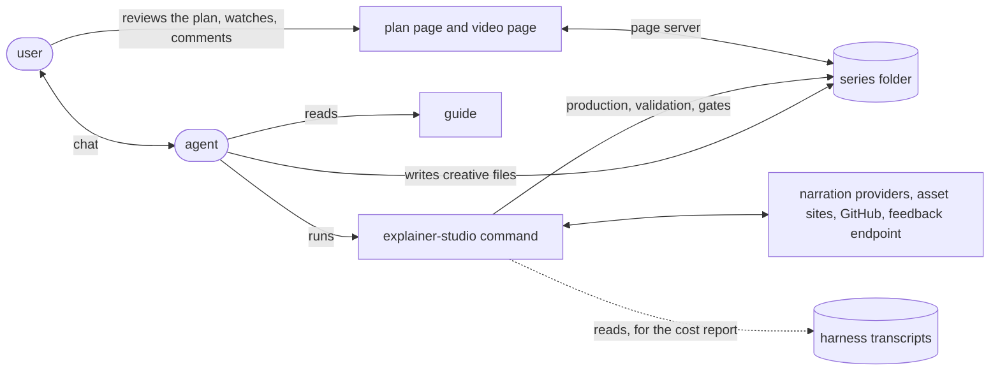
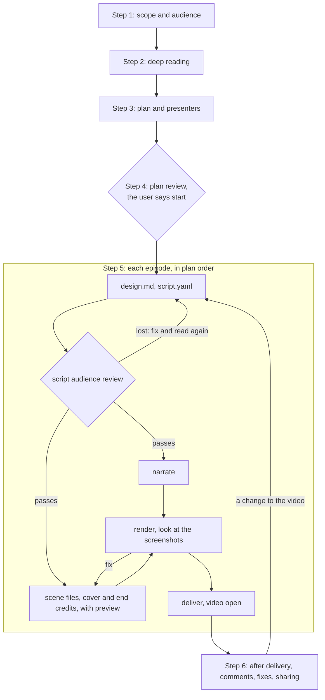
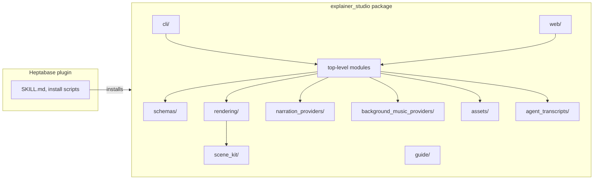

# System design

How Explainer Studio makes a video series: who does what, the flow, the parts of the program, where data
lives and what leaves the computer. Terms are defined in [glossary.md](glossary.md); every file's fields are in
[`references/file-formats.md`](../explainer_studio/guide/references/file-formats.md); how to make the videos, as the
agent reads it, is the [guide](../explainer_studio/guide/guide.md).

## The whole picture

Explainer Studio splits the work between a coding agent and a command. The agent does what needs judgment: working out
the audience (who the videos are for), reading the sources, planning, writing the script and the scene code, looking at
the result. The `explainer-studio` command does what can be checked or must be exact: narration, rendering, validation,
the gates between steps, and every call to an outside service. The command never calls a language model; all model use
is the agent's, in the harness the user runs it in.

Four choices shape everything else:

- **Files are the state.** The series folder is the whole truth: the agent writes the creative files (plan, design
  notes, script, scene code, research) directly, and the command writes what it produces beside them. There is no
  database, no init command and no hidden folder. Any agent, in any conversation, can pick up a series by reading it.
- **The agent judges; the command enforces a few gates.** The command never decides what to redo. It reuses unchanged
  narration and refuses to go on where skipping a step would cost money or ship a broken video (see
  [Gates](#gates)).
- **The guide ships with the command.** The skill in the Heptabase plugin installs the command and sends the agent to
  the guide; `explainer-studio guide` prints the guide of the installed version, so the instructions always match the
  program that runs them.
- **Pages are optional.** The plan page and the video page let the user see and react, but the agent never waits on
  them: it summarizes in chat, ends its turn, and reads the files when the user comes back.

## The flow

The guide makes a series in six steps. The first four happen once per series; the fifth repeats per episode, and the
sixth follows each delivery.

| Step | Who | Commands | Writes |
|---|---|---|---|
| 1. Scope and audience | agent, asking the user | | `research/`: notes on the viewer (probes, vocabulary, capacity) |
| 2. Deep reading | agent | | `research/`: coverage list, question map, to-verify list |
| 3. Plan and presenters | agent | `plan validate` | `plan.yaml`, its audience included; `series-bible.md` |
| 4. Plan review | user, on the plan page and in chat | `plan open` | production settings, from the page |
| 5. Design and script | agent | `script validate` | `design.md`, `script.yaml` |
| 5. Audience review | audience reviewer, a fresh subagent | `script prepare-audience-review-prompt` | `audience-reviews/script.yaml` (the agent records each round) |
| 5. Narration | command | `narrate` | `narration/`, `spending.jsonl` |
| 5. Scenes | agent or scene writers | `preview`, `asset ...` | `scenes/`, `cover.py`, `end_credits.py`, `assets/`, `preview/`, `credits.yaml` |
| 5. Render | command, then the agent looks | `render` | `render/`: video, subtitles, cover, timeline, screenshot sheets, automatic checks |
| 5. Delivery | command | `deliver`, `video open` | the video at the series root, `delivery-records/` |
| 6. After delivery | user on the video page, agent in chat | `feedback ...`, `cost show` | `feedback.json` |

Narration and scenes run in parallel: narration needs only the script, and preview does not need narration (a beat not
yet narrated lasts the language's estimated reading time). At any step, the agent records what the product could not
do as a gap (`gap add`, `gaps.json`).

### Gates

The command refuses to go on in six places, the guide's "What the CLI enforces". Each guards money or a broken
video; nothing else is enforced.

| Gate | Checked by | Rule |
|---|---|---|
| Script audience review | `narrate` | every scene read; a scene lost in its latest read is read again, settled after three rounds |
| Budget | `narrate` | spending so far plus this run's estimate stays within the narration budget; one paid run per series at a time |
| Narration | `render` | every beat narrated with its current spoken text and narration settings |
| Scene code | `preview`, `render` | Manim Community syntax and known ManimGL pitfalls are refused before rendering |
| Render | `deliver` | the render was made from the script's current narration text |
| Automatic checks | `deliver` | no automatic check found text too small in the render |

### Narration reuse

A beat counts as narrated when the narration record has it with its current spoken text, the record's settings equal
the plan's narration settings, and its audio file exists. `narrate` synthesizes only the beats that fail this test,
and `render` refuses an episode where any beat fails it. Editing a beat's narration text without changing what the
voice reads (corner brackets, which the Chinese rewrite removes, for example) keeps the audio and costs nothing.

### Rendering

`render` runs ManimGL once per scene, in parallel, each process in its own working folder. A scene writes a sidecar
with its beats' times, its sounds, its automatic check issues and file excerpts. The clips are joined in script order
behind the cover and before the end credits page (unless the plan turns it off); narration, sounds and the background music, when the plan has one, are mixed (the music ducked under speech) and
normalized; subtitles come from the beats' narration text and the timeline. Everything is written to a temporary
folder first, so a failed render leaves the previous one in place. The agent cannot watch a video, so preview and
render write screenshot sheets, and the agent looks at every one before delivering.

### After delivery

The video page shows the latest video. Its comments and survey answers go through the page server into the episode's
`feedback.json`; a remark the user makes in chat goes there through `feedback add`. When the user comes back, the agent
reads the comments without a resolution and responds in chat: it answers learning questions and explains confusing
passages, and changes the video only when the user asks or agrees, then runs again what the change needs, up to a new
delivery. It records each comment's cause and what it did as the comment's resolution (`feedback resolve`). With the
user's agreement, `feedback share` or the page's share button sends the episode's feedback bundle to the team.

## Components

| Part | Responsibility |
|---|---|
| The skill, in the Heptabase plugin (`heptameta/heptabase-agent-plugins`) | When to use Explainer Studio, installing the command (`install.sh`, `install.ps1`), then running the guide. |
| `explainer_studio/guide/` | How to make the videos: the flow, the workflows, and the references (teaching rules, presenters, languages, subjects, sources, rendering, file formats). |
| `cli/` | One module per command group. Results go to stdout and progress to stderr, in concise English meant for an agent. |
| Top-level modules | The logic of each concept: `plan`, `script`, `audience_review`, `narrate`, `deliver`, `feedback`, `feedback_bundle`, `gaps`, `spending`, `cost`, `releases`, `environment`, and so on. |
| `schemas/` | One Pydantic model per file format. The field tables in `file-formats.md` are generated from them. |
| `rendering/` | Preview and render: the ManimGL runner, scene code checks, mixing, subtitles, screenshot sheets, automatic checks. |
| `scene_kit/` | What scene files import: `NarratedScene`, components and layout helpers. |
| `narration_providers/`, `background_music_providers/` | One module per provider, each with its settings model, registered in the package's `__init__.py`. |
| `assets/` | The `asset` commands: searching and fetching pictures, data and clips, PDF pages, 3D shots (Blender) and screen recordings (Playwright), with credits. |
| `agent_transcripts/` | Reading a harness's transcripts into model calls and tool uses, for the cost report. One module per harness; only Claude Code today. |
| `web/` | The page server and the two pages (static JavaScript, no build step), with their translations. |

The page server serves both pages of one series. `plan open` and `video open` start it detached, or reuse a running
one of the same version, and return at once; `upgrade` restarts running ones with the new version, or stops one
whose plan the new version cannot open. It listens on 127.0.0.1 only, answers only paths that start with its
random token, and stops after two idle hours; started again, it takes the same port and token when it can, so an
open page keeps working after a reload.

Several processes can write one file (the agent's commands, parallel subagents, the page server), so every write
holds a lock file beside its target and lands with an atomic replace. YAML is read and written round-trip, so a save
from the plan page keeps the agent's comments and key order.

## Where data lives

| Where | What | Written by |
|---|---|---|
| Series folder root | Delivered videos, subtitles and covers | `deliver` |
| `production/` | Everything else about the series: plan, research, scripts, scene code, narration, renders, delivery records, feedback, gaps, spending, credits | the agent and the command |
| User config directory | `credentials.toml` (narration keys and the Heptabase sign-in, owner-only), `settings.toml` (dev mode), `model-prices.toml` (the price table) | `setup narration`, the video page's sign-in, `dev-mode`, the developer |
| User data directory | Programs `setup` installs: ffmpeg, TinyTeX (on Windows, under `ProgramData` when the user path has spaces or non-ASCII characters), Blender, map data | `setup` |
| The system's user font folder | The fonts the videos use | `setup` |
| Playwright's own folder | The Chromium that screen recordings use | `setup playwright` |
| User cache directory | The latest-release check, running page servers' port and token, scratch files only the agent reads (audience review prompts, thumbnail sheets; removed after seven days) | the command |
| The harness's own folder | Transcripts of the agent's conversations, read for the cost report and never written | the harness |

Nothing about a series is kept outside its folder except the page server's runtime info and the agent's scratch files.
A key is never in the series folder: narration reads it from the provider's environment variable or from
`credentials.toml`.

## The series' whiteboard

The video page shows every delivered episode's cards on one whiteboard for the series, drawn by Heptabase: the page
embeds the Heptabase web app's embedded whiteboard page in an iframe. Studio owns the content, the ids and the layout;
Heptabase measures, draws and stores, and knows nothing of series or episodes. Until the user saves, the cards never
leave the computer. **Save to Heptabase** signs in once per computer and puts the episodes on a new whiteboard in the
user's Heptabase, linked from `production/heptabase-whiteboard.json`; each episode delivered later is added once, and
the whiteboard is the user's from then on. How each step works, and the messages and requests Studio relies on from
Heptabase, are in [series-whiteboard.md](series-whiteboard.md).

## What leaves the computer

What users are told about this, feedback sharing above all, is in [PRIVACY.md](../PRIVACY.md).

| To | What | When |
|---|---|---|
| The narration provider (ElevenLabs, OpenAI or VoAI) | Each beat's spoken text and the episode's narration settings (for OpenAI, its voice instructions), with the user's key; ElevenLabs also gets the neighbouring beats' spoken text, for intonation | `narrate` |
| The same provider | The key the user enters, to test it | `setup narration` |
| Asset sites (Wikimedia Commons, Bioicons, Wikipedia, Our World in Data, the World Bank) | Search queries and downloads | `asset` commands |
| A web page the agent records | A visit by a headless browser | `asset playwright record` |
| GitHub | Reading release tags; installing a release | `doctor` (at most daily), `upgrade` |
| The sites the install scripts, `setup` and `upgrade` download from (astral.sh for uv, PyPI, GitHub, CTAN mirrors for TeX packages, Blender, Playwright's browser) | Downloads | installing, `setup`, `upgrade` |
| The Heptabase feedback endpoint | A feedback bundle | `feedback share` or the video page's share button, only with the user's agreement |
| Heptabase (its OAuth server and REST API, and its web app's embedded whiteboard page in the video page) | The embedded page's load (the cards stay in the browser); the sign-in and the account it is for; then the series', episodes' and chapters' titles, the cards, their pictures and where they go, onto a whiteboard in the user's own Heptabase | The page load with the whiteboard view (or in the background for a saved series with episodes to add); the rest with the video page's **Save to Heptabase**, and once saved, every episode not on it yet whenever one of the series' video pages opens |

The macOS voice and the background music are made on the computer. A feedback bundle carries the episode's
`feedback.json`, its comment screenshot sheets, the `metadata.json`, `script.yaml` and `timeline.json` of every delivery
record, the plan, `gaps.json`, the cost report of the series' planning and the episode (the agent's usage, and the
narration's estimated cost) and the Explainer Studio version and operating system. It never carries the sources, the
video file or the audio; the comment screenshot sheets are the only frames of the video in it. A file that a symbolic
link or `..` takes outside its place in the series folder stops the share instead of being packed. Each item records
which bundle first carried it, so a share knows whether there is anything new to send.

## Versions and upgrades

A release is a `v<version>` tag on `main`. The agent runs `explainer-studio upgrade` before starting a series or an
episode; it installs the latest release with `uv tool install` when it is newer (on Windows, where a running command
cannot replace itself, it asks for the install script instead), runs `setup` for what the new version needs, replaces
the page servers the earlier version left running, and prints the [UPGRADING.md](../UPGRADING.md) steps that series made
with the earlier version may need; the agent applies them to the series it works on. The agent never upgrades between an
episode's `narrate` and its `deliver`, so one video is made with one version.

Every command that makes an episode's video records its version in `explainer-studio-versions.json`. When the version
differs from the episode's last recorded one, the command tells the agent to read the guide again and what the
series may need; a delivery record keeps the version that delivered and any others used since the previous delivery.
A dev build (`scripts/use_dev_build.py`) replaces the command on one computer for every chat at once, and `upgrade`
leaves it alone.

## Observation

The cost report is worked out when asked (`cost show`; in dev mode, `deliver` and the video page; a feedback share),
never stored. It reads the harness's transcripts of the conversations that made something in the series, assigns each
model call to a step by the command it ran or the file it touched, and counts paid narration from `spending.jsonl`.
Reading the transcripts uses only commands, file paths, times, model settings and token counts; the report itself
keeps times, steps, model settings and token counts, never what was said. What dev mode adds is in the
[glossary](glossary.md#observation).
