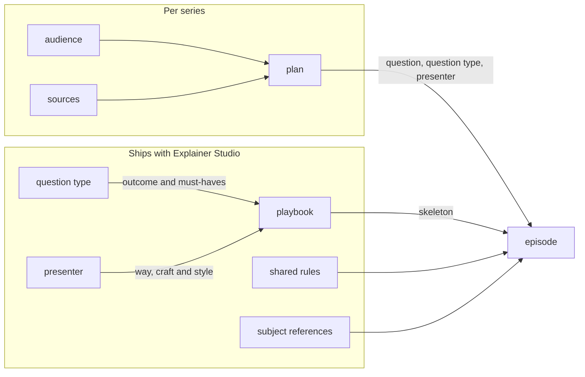

# Teaching model

How Explainer Studio decides what each video teaches and how it teaches it: the layers of the model and what each one
decides, how to tell them apart, the presenters it has today, and how the model changes. The terms are defined in the
[glossary](glossary.md#teaching-design). The method the agent follows is in the guide's
[teaching references](../explainer_studio/guide/references/teaching/) and
[presenters reference](../explainer_studio/guide/references/presenters/README.md), and how a change to them is judged
is in [judging-changes](../.claude/skills/judging-changes/SKILL.md).

## What an episode is for

An episode succeeds when this viewer can do something afterwards that they could not do before: explain a causal chain
in their own words, follow a proof, tell examples of a concept from non-examples, judge a claim. Three ideas shape the
rest of the model:

- **It depends on the viewer.** The same explanation is just right for one person and too fast or too slow for another,
  so every judgment rests on the audience: what the viewer already knows and pictures, which terms are new to them,
  what they wrongly believe, and how much they can take in per episode. The agent finds this out with probes made from
  the sources themselves, never by asking the user their level.
- **What must be achieved is separate from how.** What the viewer can do afterwards, and what an episode must contain
  for that, depend only on the kind of question it answers. How to get there is a teacher's way, and very different
  ways can reach the same outcome.
- **An episode keeps one way.** Each episode is taught by one presenter, in that presenter's way from start to finish;
  different teachers' ways are never averaged together.

The principles every presenter follows (start from the model already in the viewer's head, make them want the answer
before giving it, concrete before abstract, one core idea per video, and more) are in
[teaching/rules.md](../explainer_studio/guide/references/teaching/rules.md#principles-every-presenter-follows).

## The layers

Two kinds of layer meet in every episode. The audience and the plan are worked out for each series, with the user. The
question types, presenters, playbooks, shared rules and subject references ship with Explainer Studio: they change
only with a release, never for one series.

Paths under `references/` are inside `explainer_studio/guide/`.

| Layer | What it decides | Where it is written |
|---|---|---|
| **Audience** | Who the series is for: what they know and picture, the terms new to them, their misconceptions, how much they can take in per episode, and what they want | The plan (`plan.yaml`); how to find it out: [teaching/audience.md](../explainer_studio/guide/references/teaching/audience.md) |
| **Plan** | How many episodes, the one main question each answers and its question type, their order, who presents each | `plan.yaml`; the method: [teaching/plan.md](../explainer_studio/guide/references/teaching/plan.md) |
| **Question type** | What the viewer can do after an episode, and the must-haves that get them there; nine in all | [teaching/question-types.md](../explainer_studio/guide/references/teaching/question-types.md) |
| **Presenter** | A way of making people understand that holds for every question type they teach: what the viewer does, what the picture is, the role of real examples, when things get their names; their script craft and visual style | `references/presenters/<presenter>/` |
| **Playbook** | How one presenter answers one question type: the skeleton from opening to close, how it meets the must-haves, the short version, the quality bar, the self-check | `references/presenters/<presenter>/question-types/<type>.md` |
| **Shared rules** | The principles every presenter follows, and what the tools enforce for every viewer | [teaching/rules.md](../explainer_studio/guide/references/teaching/rules.md), `visual.md` |
| **Subject reference** | What counts as explained in a subject, and how to be honest about it | [references/subjects/](../explainer_studio/guide/references/subjects/) |

How they relate:

- The plan comes from the audience and the sources. Presenters do not decide it: the same sources and the same viewer
  give the same episodes, each answering the same question, whoever presents them.
- A question type is the same for every presenter and never says how to teach. Several presenters can each have a
  playbook for it, with completely different skeletons, all meeting its must-haves.
- The shared rules, and the subject reference when there is one, hold whatever presenter and playbook an episode uses.

How episodes, presenters, playbooks and question types relate one to one or one to many is in the glossary's
[teaching design](glossary.md#teaching-design) diagram.

The guide's source references (how to read a paper, a book chapter, a codebase) and language references belong to the
engine and tools, not to the teaching model: they change how sources are read and voices speak, not what an episode
teaches.

As an analogy, think of a restaurant. The viewer is the guest, and the audience is what the restaurant knows about them:
what they have eaten before and how much they can eat. The plan is the menu for that guest. A question type is a course,
defined by what it must do for the guest rather than by how it is cooked. A presenter is a chef with a cuisine of their
own, and a playbook is that chef's recipe for one course; a draft playbook is a recipe worked out for one night. The
shared rules are the standards every chef keeps, and the engine and tools are the kitchen. The analogy stops there:
everywhere else, the names are the ones above.

## Telling the layers apart

A piece of teaching advice belongs to one layer. Four tests place it:

- **Question type or playbook?** A question type can be said in one sentence without naming a subject or a kind of
  source, and what it lets the viewer do differs from every other type. "Explain a paper" is not a question type: a
  paper is a kind of source, and one paper may be answering "why should we believe this claim?" or "how does this new
  method work?". Anything about how to teach belongs to the presenter or a playbook; the next test tells which.
- **Presenter or playbook?** Move the advice to another question type the presenter has a playbook for. If it still
  holds, it is about the presenter; if it holds for only one question type, it is about that playbook. "The viewer
  takes an actor's seat and decides" holds in Fabian's mechanism, argument and system playbooks alike, so it is Fabian;
  "change only one condition and play a new round" is how he meets mechanism's "predict what changes when one condition
  changes", so it belongs to his mechanism playbook.
- **Another presenter, another playbook, or style?** A difference that holds for every question type (what the viewer
  does, what kind of thing the picture is, the role of real examples) makes another presenter. A difference in one
  question type only is a new version of that playbook. A difference only in tone, colour or pace is style.
- **Plan or presenter?** How many episodes there are and what each answers come from the viewer and the sources. Who
  presents an episode decides only how it is taught.

## Choosing a presenter

For each episode, the candidates are the presenters with a playbook for its question type. Perspectives, narrative and
proof have one each (Sophie, Clio and Theo). For the other question types, the shape of the answer decides, through
four questions asked in order (each only for some question types, as
[the presenters reference](../explainer_studio/guide/references/presenters/README.md#the-same-question-type-several-presenters-playbooks)
says):

1. If all the facts were known, would the disagreement remain (over what matters most, how a text should be read, or
   where a line is drawn by value judgment)? Sophie.
2. Does the answer depend on the particular people, timing and chance of one time? Clio.
3. Does the answer grow out of several actors, each with their own aims, affecting each other? Fabian.
4. Does the behaviour only show when it runs, with no easy formula? Mason. Otherwise, Theo.

Procedure and concept have their own questions instead of some or all of these (for procedure, whether its most common
mistake is thinking wrong or only shows when run), and conceptual change asks another first question; the table in the
presenters reference gives each question type's rule.

When two shapes both make sense, the presenter probe decides: early on, the agent shows the user a passage in each
candidate's way and asks which they would rather keep listening to. When candidates fit equally, the one who can present
the most episodes is chosen, so the series keeps one voice, visual style and set of characters.

## The presenters today

| Presenter | What kind of teacher | What the viewer does |
|---|---|---|
| **Theo** | The teacher at the blackboard: rebuilds the idea step by step in pictures, until the result looks almost inevitable | Watches the idea being built, block by block; where they want to know, thinks for a moment first |
| **Fabian** | The teacher who runs a board game: turns the problem into a small world and lets you play a round | Takes an actor's seat and decides, then sees what happens when everyone does the same |
| **Mason** | The teacher in the workshop: builds a minimal version that really runs, and lets what it produces say why | Guesses what a run will produce, then lets the run decide |
| **Sophie** | The seminar teacher: has you judge a case, changes one thing, and draws a principle out of where your judgments do not fit together | Sits as the judge, and sees each verdict tested by the next case or the strongest reason |
| **Clio** | The teacher who spreads out a map and walks you through the crossroads: shows the ending on a big-picture map, then stops at each crossroads to lay out the roads there were and why this one was taken | Stands where the people stood at the time, guesses which road they will take, then sees the real choice |

Their playbooks, by question type, each named by its title:

| Question type | Theo | Fabian | Mason | Sophie | Clio |
|---|---|---|---|---|---|
| Mechanism | Explain a mechanism | Explain a mechanism | Explain a mechanism | | |
| Proof | Find the proof | | | | |
| Concept | Enclose a concept | Separate a concept | Turn a knob to sort the kinds | Draw a line | |
| System | Walk through a system | Walk through a system | Walk through a system | | One part, one crossroads |
| Procedure | Reinvent a procedure | | Show it once | | |
| Narrative | | | | | Walk the crossroads |
| Conceptual change | How an idea changed | | Run the old method until it breaks | How an intuition was overruled | Same question, two tables |
| Argument | Test an argument | Test an argument | Test an argument | Try a claim | Walk the same road twice |
| Perspectives | | | | A seminar | |

Each empty cell is a question type whose must-haves conflict with that presenter's way, listed as "not a fit" in their
`presenter.md`. For example, a mechanism's answer must still hold with names, years and chance removed, and Clio's
answers depend on exactly those. Each presenter's full description and models are in the
[presenters reference](../explainer_studio/guide/references/presenters/README.md#each-presenter-side-by-side), and the
reasons for each playbook and each "not a fit" in their own `presenter.md`.

## Draft playbooks

When an episode's presenter has no playbook for its question type, the agent writes a draft playbook in the episode's
design notes before the script: the items a playbook covers, in that presenter's way, meeting the question type's
must-haves. This happens when the shape of the answer fits only a presenter without a playbook for that question type,
or when the presenter whose way comes closest has none. The plan page marks such an episode: it may be rougher, and
its feedback matters most. Today each of a presenter's nine question types either has a playbook or is not a fit, so
a draft playbook arises only in the second case. Draft playbooks are also how a new playbook or presenter is tried
before it ships.

## How the model changes

The model changes only with a release, on evidence from real videos. Every rule has a cost: it can overfit one source
and hold back the next, stronger model. So each change says how it trades quality, cost and time, and rule
complexity ([judging-changes](../.claude/skills/judging-changes/SKILL.md)). The evidence a change needs grows with its
reach:

| Change | Evidence |
|---|---|
| A fix to the engine and tools | Seen once |
| A teaching change: knowing the viewer, planning, a shared rule, a subject reference, a presenter's craft, a playbook | The same cause in two different sources |
| A new playbook for a presenter | The presenter's way can carry the question type, and episodes made with a draft playbook for it were judged good on two different sources |
| A new presenter | Some question type or viewer that no existing way can teach, where the cause is the way, not the skeleton; tried first in episodes with draft playbooks |
| A new question type | The sources keep asking a kind of question whose outcome no existing type describes; each new type is another way to misjudge an episode's question type, so more are not better |
| Merging | Two question types whose outcomes have become the same, or two presenters whose ways turn out to be one |

When a viewer's comment points at a teaching problem, its cause decides where the fix goes. A badly written line
changes only that video. A badly arranged episode is rearranged by the planning rules, and only the same problem across
different videos changes a playbook. Something that always makes viewers stuck becomes a gap for the tools to catch.
One comment never shows that a playbook is wrong
([teaching/feedback-analysis.md](../explainer_studio/guide/references/teaching/feedback-analysis.md)).
